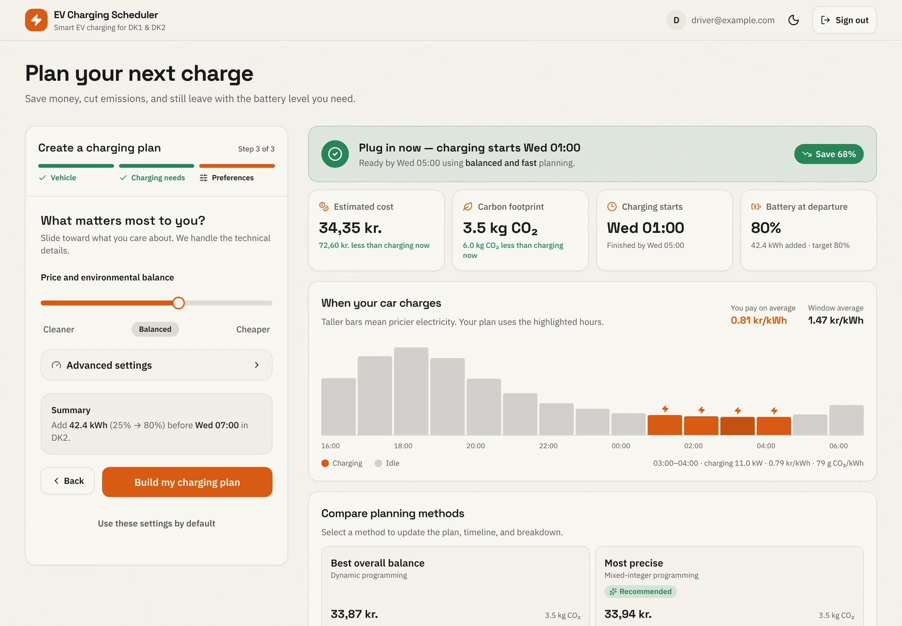
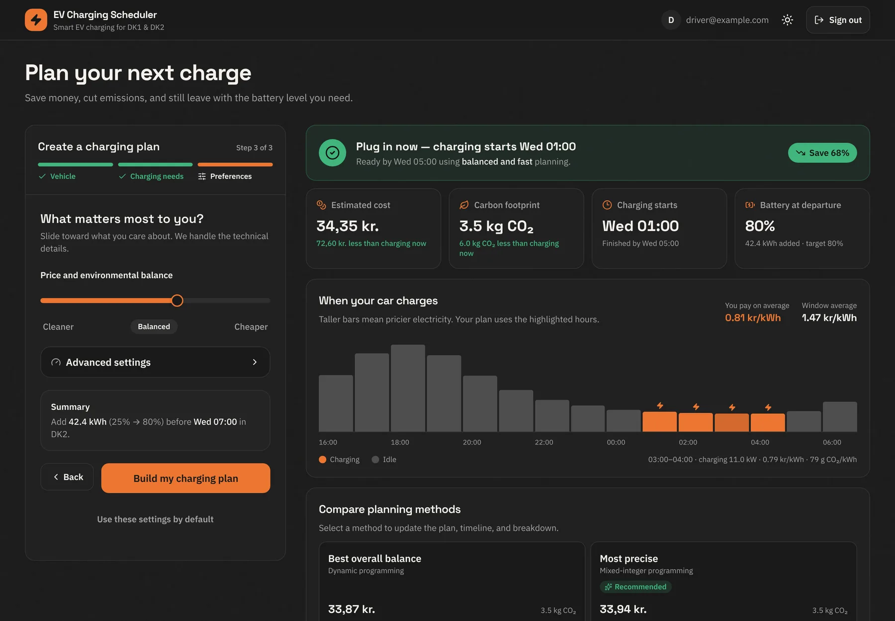
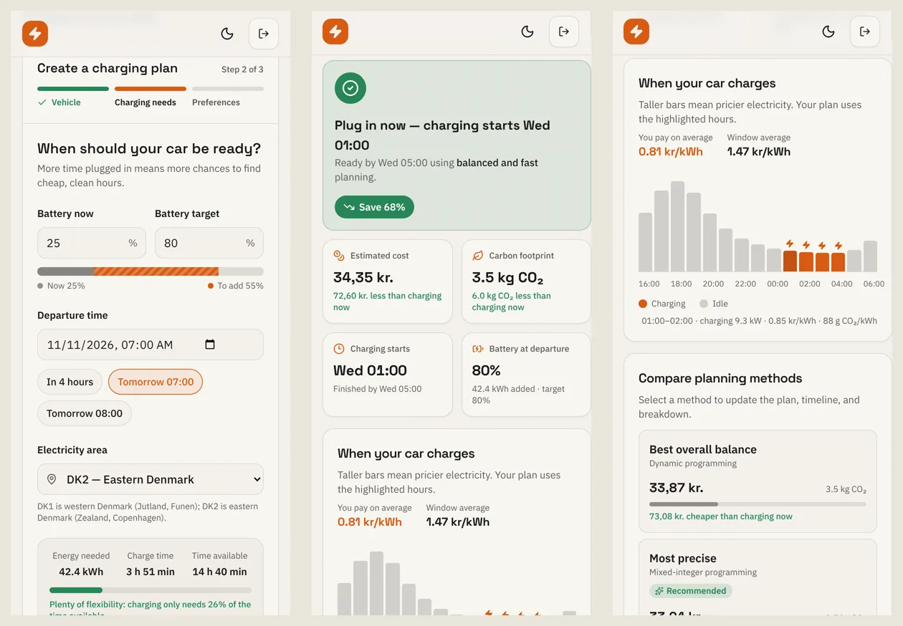
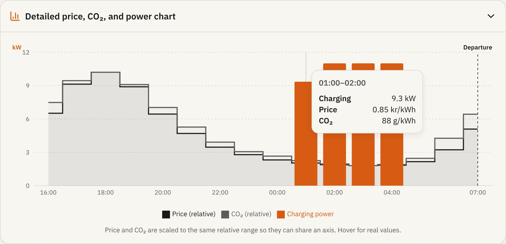
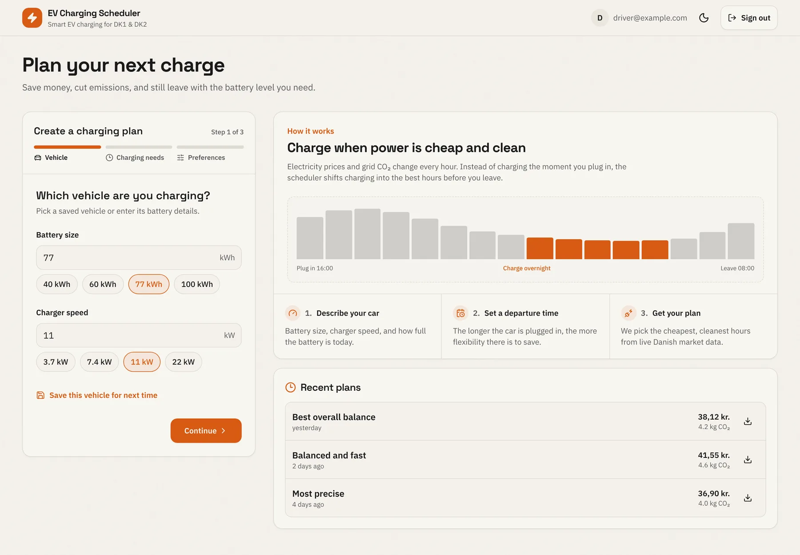
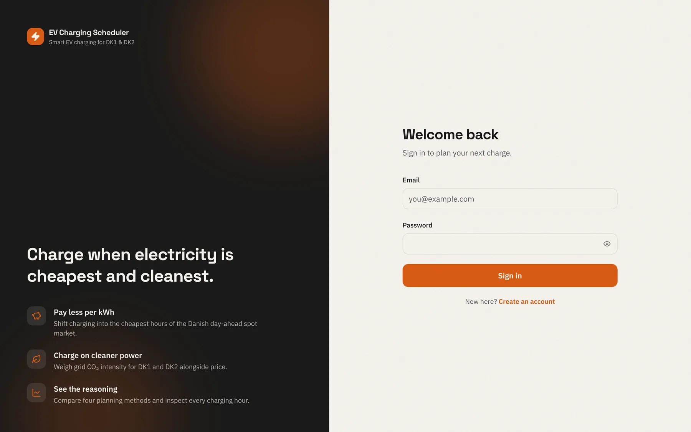
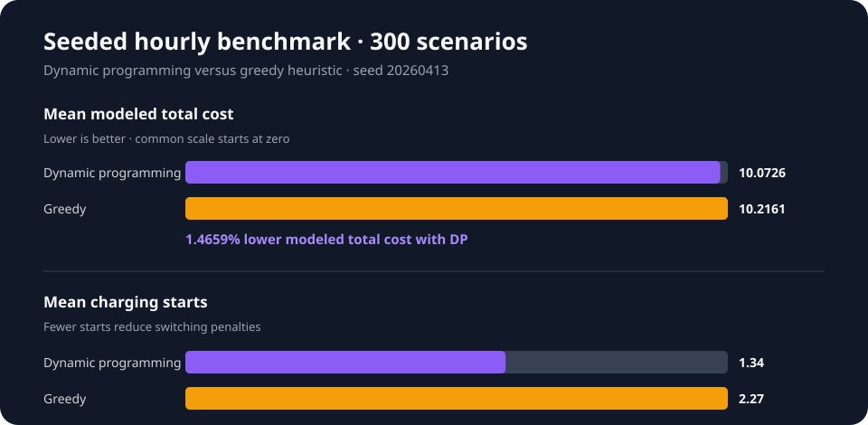

# Intelligent EV Charging Scheduler

[](https://github.com/ahmeddeeqabdi/Final-Project---Intelligent-EV-Charging-Schedule/actions/workflows/ci.yml)

A full-stack application that creates EV charging schedules from electricity prices, CO2 intensity, vehicle constraints, and a user-selected optimization strategy.

## Highlights

- Four scheduling strategies: naive, greedy, dynamic programming, and mixed-integer programming
- Live Danish market data for DK1 and DK2, with cached-data fallback
- JWT authentication, saved user constraints, and role-protected admin tools
- Guided three-step planner with an hour-by-hour charging timeline, strategy comparison, and light/dark themes
- Responsive React and TypeScript dashboard that works on phones as well as desktops
- Unit, integration, and randomized algorithm tests

## Product tour


<sub>▶ [Watch the walkthrough as an MP4](./docs/media/demo.mp4) · Screenshots and recordings use sample market data.</sub>

### Your charging plan at a glance

After three short steps (vehicle, charging needs, preferences), the dashboard
answers the questions a driver actually has: *when does charging start, what
will it cost, and how much does waiting save compared with charging right
away?* The **When your car charges** timeline shows electricity price for every
hour until departure and highlights the hours the plan uses.



### Compare strategies, light or dark

Every planning method runs side by side, and the recommendation follows the
price/CO₂ balance you choose. Selecting a method updates the summary,
timeline, and hourly breakdown. The whole interface has a dark theme.



### Built for phones

The planner, results, and timeline adapt to small screens. Tapping a timeline
bar shows that hour's price, CO₂ intensity, and charging power.



<details>
<summary><strong>More screenshots</strong></summary>

**Detailed price, CO₂, and power chart**



**First visit: how the scheduler works**



**Sign in**



</details>

Users can also save vehicle profiles, store default preferences, revisit
recent plans, and export a plan to CSV or a calendar event.

## Measured algorithm tradeoff

The seeded regression benchmark uses 300 synthetic but realistic hourly
charging scenarios. In the verified run, dynamic programming reduced modeled
total cost by **1.4659%** versus the greedy heuristic and reduced mean charging
starts from **2.27 to 1.34**.



See the [benchmark methodology, results, and limitations](./docs/benchmark-report.md).

## Technology

- Java 25 and Spring Boot 4
- React 19, TypeScript, and Vite
- PostgreSQL for normal operation; H2 for local development and tests
- Google OR-Tools for mixed-integer optimization

## Repository layout

```text
.
├── backend/              Spring Boot API and backend tests
├── frontend/             React application
├── docs/                 Architecture notes, benchmark report, and README media
├── .github/workflows/    Continuous integration
├── compose.yaml          Complete local application stack
└── .env.example          Environment variable template
```

Backend and frontend dependencies remain independently managed. A Maven package build also compiles the frontend and embeds its production assets in the Spring Boot artifact.

## Requirements

- Java 25
- Node.js 24 and npm 11
- Docker with Docker Compose, when using PostgreSQL locally

The Maven package build can install its configured Node and npm versions. Direct frontend development still requires Node and npm on your machine.

## Quick start with local H2

The `local` Spring profile uses an ignored H2 database under `backend/.data/` and a development-only JWT secret.

Start the backend:

```bash
cd backend
./mvnw spring-boot:run -Dspring-boot.run.profiles=local
```

On Windows, use `mvnw.cmd` instead of `./mvnw`.

Start the frontend in another terminal:

```bash
cd frontend
npm ci
npm run dev
```

Open `http://localhost:5173`.

## Run the complete stack with Docker

Build and start the packaged frontend, Spring Boot API, and PostgreSQL from the
repository root:

```bash
docker compose up --build
```

Open `http://localhost:8080`. Compose uses local-development credentials by
default; override them through `.env` before exposing the application outside
your machine.

Stop the stack with `docker compose down`. PostgreSQL data is retained in the
named `postgres_data` volume.

## Run PostgreSQL with the application outside Docker

Start only the database:

```bash
docker compose up -d postgres
```

Before starting the backend without the `local` profile, set a strong JWT secret of at least 32 characters:

```bash
export APP_JWT_SECRET="replace-with-a-long-random-secret"
cd backend
./mvnw spring-boot:run
```

PowerShell equivalent:

```powershell
$env:APP_JWT_SECRET = "replace-with-a-long-random-secret"
Set-Location backend
.\mvnw.cmd spring-boot:run
```

## Configuration

| Variable | Required | Default | Purpose |
| --- | --- | --- | --- |
| `APP_JWT_SECRET` | Yes, except with `local` profile | None | JWT signing secret; use at least 32 characters |
| `APP_CORS_ALLOWED_ORIGINS` | No | `http://localhost:5173` | Comma-separated trusted frontend origins |
| `APP_JWT_EXPIRATION_MS` | No | `3600000` | Token lifetime in milliseconds |
| `DB_URL` | No | `jdbc:postgresql://localhost:5432/mydatabase` | JDBC connection URL |
| `DB_USERNAME` | No | `postgres` | Database user |
| `DB_PASSWORD` | No | `postgres` | Database password for local Compose setup |
| `APP_DATA_SYNC_HISTORICAL_ENABLED` | No | `true` in Spring, `false` in Compose | Backfill three months of grid data at startup |
| `POSTGRES_PORT` | No | `5432` | Host port exposed by the PostgreSQL container |
| `APP_PORT` | No | `8080` | Host port exposed by the application container |

Copy [.env.example](./.env.example) when configuring an IDE or deployment environment. Spring Boot does not automatically load `.env` files in a normal shell, so export the variables or configure them through your runtime.

New accounts receive the `USER` role. To provision an administrator, register the account and promote it through a trusted database session:

```sql
UPDATE app_users SET role = 'ADMIN' WHERE email = 'admin@example.com';
```

## Development commands

Backend tests:

```bash
cd backend
./mvnw test
```

Frontend checks:

```bash
cd frontend
npm ci
npm run lint
npm run typecheck
npm test
npm run build
```

Full Maven package, including the frontend production build:

```bash
cd backend
./mvnw package
```

The scheduling strategy design is documented in [docs/strategy-pattern.md](./docs/strategy-pattern.md).
PostgreSQL schema changes are versioned through Flyway migrations under
`backend/src/main/resources/db/migration`; Hibernate validates the migrated
schema at startup.

## Security

- Do not commit `.env` files, `.data/`, database exports, signing keys, or production credentials.
- Production startup requires `APP_JWT_SECRET`; the built-in fallback exists only in the `local` profile.
- Configure `APP_CORS_ALLOWED_ORIGINS` to the exact deployed frontend origins.
- Use a dedicated database account and strong password outside local development.

Report security concerns according to [SECURITY.md](./SECURITY.md).

## License

Licensed under the [MIT License](./LICENSE).
