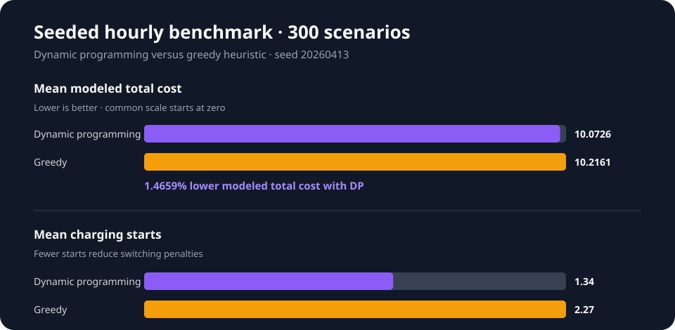

# Benchmark report

This benchmark compares the dynamic-programming strategy with the greedy
heuristic under the same deterministic set of synthetic charging scenarios.
It is a regression and engineering benchmark, not a claim about guaranteed
consumer savings.

## Method

- Seed: `20260413`
- Scenarios: `300`
- Resolution: one-hour market and charging slots
- Charging window: 4–24 hours
- Battery capacity: 40–100 kWh
- Maximum charging power: 3.7, 7.4, 11, or 22 kW
- Objective inputs: normalized electricity price and CO2 intensity
- Real-world cost model: electricity cost, charging efficiency, and switching
  penalties

The production benchmark endpoint and the regression test use the same
`BenchmarkScenarioFactory`, preventing their time-resolution assumptions from
drifting apart.

## Verified result

The result below was produced on 2026-09-14 with:

```bash
cd backend
./mvnw --batch-mode -Dtest=StrategyBenchmarkRandomizedTests test
```

| Metric | Dynamic programming | Greedy | Interpretation |
| --- | ---: | ---: | --- |
| Mean modeled total cost | 10.0726 | 10.2161 | DP was 1.4659% lower |
| Mean electricity-only cost | 8.7639 | 8.6837 | Greedy bought slightly cheaper energy |
| Mean charging starts | 1.34 | 2.27 | DP reduced switching |
| Mean efficiency-loss cost | 0.9738 | 0.9649 | DP traded a small efficiency loss for fewer starts |



## Interpretation and limitations

The dynamic-programming strategy optimizes the complete modeled cost, so its
electricity-only cost can be slightly higher while its total cost is lower.
The 1.4659% result is specific to this seeded synthetic data set and the stated
cost model. It should be described as a modeled benchmark result rather than
measured household savings. Runtime values are intentionally omitted from the
static figure because they depend strongly on hardware and JVM warm-up.
